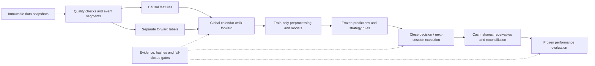

# Quant Research Lab

**A leakage-aware, multi-asset machine-learning research system — built to test claims, not to manufacture attractive backtests.**

[中文概览](docs/README.zh-CN.md) · [Research design](docs/research-design.md) · [Engineering evidence](docs/engineering-evidence.md) · [Publication boundaries](docs/publication-policy.md)

This repository is the **sanitized engineering release** of a staged ETF research project. It exposes the implementation, fixed research conventions, and an offline synthetic test suite. It does **not** distribute market data, trained models, private experiment outputs, or the sealed evaluation payload.

The research question is whether historical daily information provides stable out-of-sample evidence about five-session ETF returns, and whether any predictive evidence survives realistic accounting and trading frictions. A weak or negative result is a valid outcome.

## What to inspect first

| Research concern | Implementation | Executable evidence |
|---|---|---|
| Future information entering features | [Asset/event-segment feature builder](src/features/builder.py) | [Future perturbation and asset isolation tests](tests/test_features.py) |
| Overlapping training and test labels | [Expanding walk-forward split](src/validation/walk_forward.py) | [Endpoint-based purge tests](tests/test_walk_forward.py) |
| Unfair per-asset versus pooled comparison | [Shared 17-feature contract](config/scale_free.yaml) | [Scale-free feature tests](tests/test_scale_free.py) |
| Training preprocessing seeing test data | [Unified model factory](src/models/factory.py) | [Train-only scaler and deterministic fit tests](tests/test_models.py) |
| Trading on information unavailable at decision time | [Decision and order contracts](src/portfolio/orders.py) | [Next-session execution tests](tests/test_strategy_orders.py) |
| Dividends or splits creating artificial profit | [Accounting engine](src/backtest/engine.py) | [Literal cash-flow and corporate-action tests](tests/test_execution_engine.py) |
| Unknown corporate-action terms | [Delayed-action accounting](src/backtest/phase6a5/engine.py) | [Pending-state and NAV conservation tests](tests/test_phase6a5_engine.py) |
| Metrics concealing risk or undefined cases | [Performance definitions](src/evaluation/phase8/metrics.py) | [Hand-calculated metrics tests](tests/test_phase8_metrics.py) |

## Run the public demonstration

Use **Python 3.12**; the original research baseline is **3.12.14**. The public environment is intentionally smaller than the private data-acquisition environment.

```bash
python -m venv .venv
# Linux/macOS: source .venv/bin/activate
# Windows PowerShell: .venv\Scripts\Activate.ps1
python -m pip install -r requirements.txt
python -m pip check
python -m pytest -q
python -m examples.synthetic_research_demo
python tools/check_publication.py
```

The demo constructs artificial observations and manual orders, checks causal invariants, and prints an accounting fingerprint. **Its values are not historical investment results.** Tests do not download data; model tests fit small synthetic datasets only.

Private publication/replay commands in the reference implementation require original hash-bound inputs that are deliberately absent here. Their refusal to run without those inputs is intentional. This public release reproduces engineering invariants, **not the complete private historical experiment**.

## Research architecture



The registered universe spans domestic equity, technology, bonds, gold, and cross-border equity ETFs. Dates refer to the ETF's domestic listing venue. Assets retain their own observable history in an unbalanced panel; missing pre-listing observations are never manufactured.

The final development strategy definitions are fixed: per-asset logistic classification with probability **strictly greater than 0.55**, pooled random-forest regression with prediction **strictly greater than 0.001**, and an available-asset equal-weight benchmark. Rebalance every five global sessions, with no annual reset; target weight is `min(0.25, 1 / n_eligible)`. No leverage, shorts, broker connection, or automatic live execution.

## What the project does — and does not — establish

The private development interpretation was **Level 1: localized or weak historical economic evidence, with insufficient stability**. This is a qualitative summary of an internal experiment, not an independently reproducible performance claim in this repository. No selected return chart or headline profitability number is published here.

Two limitations materially affect interpretation:

- Historical frozen prediction coverage depended partly on label availability. Missing predictions can produce cash positions without demonstrating successful market timing. This is not a complete point-in-time deployment simulation.
- An external search incident exposed target-related outcome information before the final evaluation was run. The models, strategy rules, and evaluation protocol had already been frozen. The prospective evaluation's identity was permanently downgraded to `protocol_locked_non_pristine_holdout_evaluation`. It must never be called pristine holdout confirmation. See [research integrity](docs/research-integrity.md).

## Relevance to research engineering

The transferable contribution is an experiment system: explicit hypotheses, controlled comparisons, temporal validity, reproducible artifacts, numerical invariants, and honest uncertainty. Finance is the application domain; this is **not** presented as a scientific discovery or evidence that a trading model will earn money.

Development used AI-assisted coding with human-directed research scope, staged acceptance, fixed protocols, and explicit incident adjudication. AI assistance is disclosed rather than presented as unaided authorship. See [engineering evidence](docs/engineering-evidence.md) for suggested review and interview entry points.

No investment advice or future-return guarantee is offered. Always examine look-ahead bias, survivorship bias, and transaction costs.
